<h1 data-importer="text" align="center">Hi! This is MoLerSTH's GitHub Homepage</h1>

###

 

###

Let me start with a quick introduction. My name is Hattakorn Pongsawai, but you can call me "Gusto". I’m currently a 3rd-year Software Engineering student at Thammasat University. I’m mainly interested in Software Engineering with a focus on Backend,  though I’m totally up for Full-stack as well! haha.

###

<h2 data-importer="text" align="left">Frameworks & Programming Languages</h2>

###

  
  
  
  
  
  
  
  
  
  
  
  
  
  
  
  
  
  
  
  
  
  
  
  
  
  
  

###

<h2 data-importer="text" align="left">Tools & Infrastructures</h2>

###

  
  
  
  
  
  
  
  
  
  
  
  
  
  
  
  
  
  
  
  
  
  
  
  
  
  
  
  
  
  
  

###

 

<picture data-importer="pacman">
  <source media="(prefers-color-scheme: dark)" srcset="https://raw.githubusercontent.com/MoLerSTH/MoLerSTH/pacman-output/pacman-contribution-graph-dark.svg?game=pacman">
  <source media="(prefers-color-scheme: light)" srcset="https://raw.githubusercontent.com/MoLerSTH/MoLerSTH/pacman-output/pacman-contribution-graph.svg?game=pacman">
  
</picture>

###
